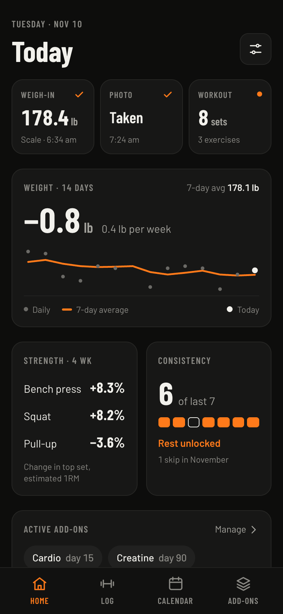
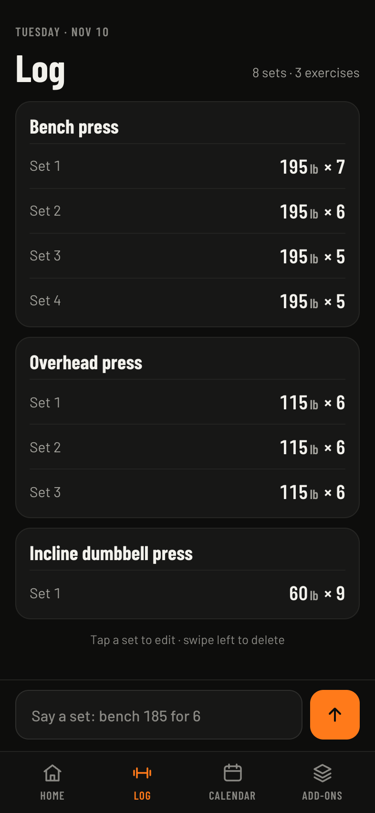
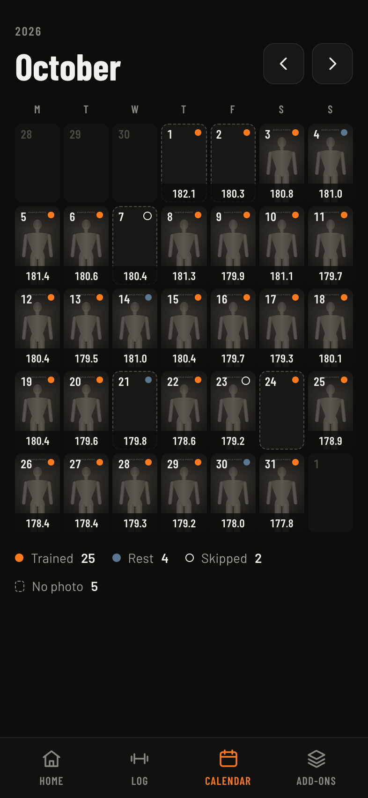
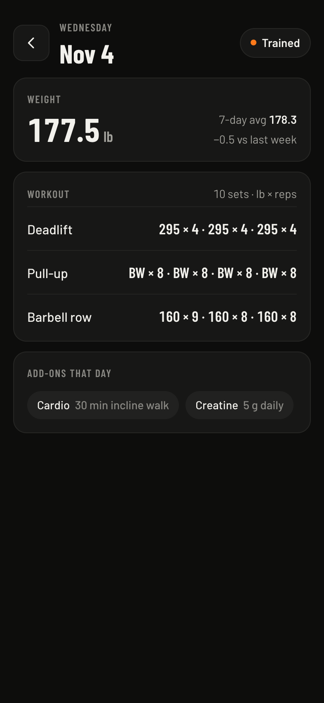
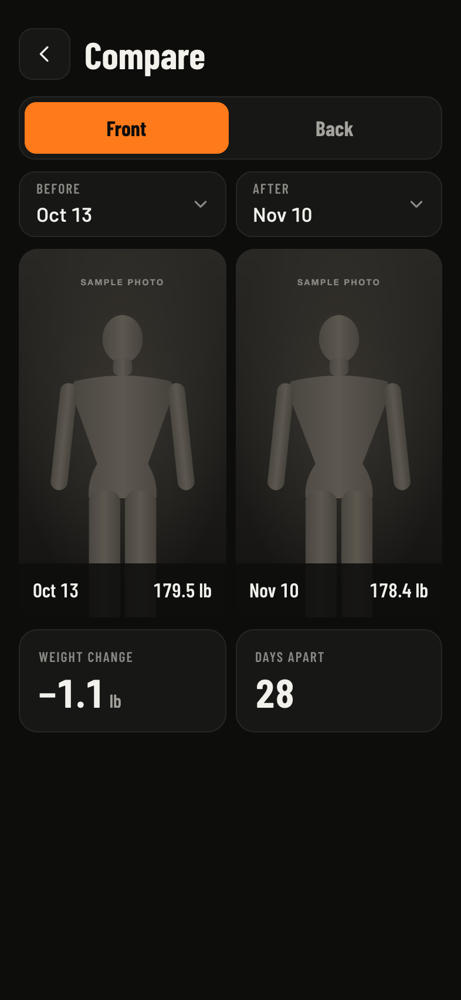
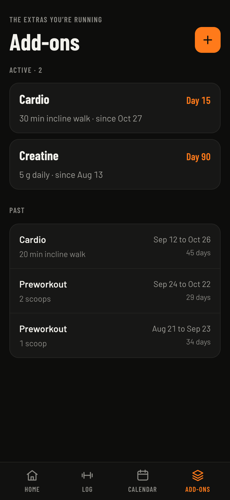

# Gym tracker

A personal, mobile-first gym tracker that runs as an iPhone home-screen web app. It captures your morning weight, your sets, a daily progress photo, the extras you're running, and whether each day was trained, rest or skipped. Claude does the analysis, reading the data through a read-only [MCP](https://modelcontextprotocol.io) server built into the app.

Each deployment has one owner. It runs on Next.js, Vercel and Supabase. The product and build spec is in [docs/SPEC.md](docs/SPEC.md).

<table>
  <tr>
    <td align="center"><br>Home</td>
    <td align="center"><br>Log</td>
    <td align="center"><br>Calendar</td>
  </tr>
  <tr>
    <td align="center"><br>Day</td>
    <td align="center"><br>Compare</td>
    <td align="center"><br>Add-ons</td>
  </tr>
</table>

The screenshots show the fake data from `npm run seed`.

## What it captures

- **Morning weight.** A smart scale posts each weigh-in through an ESP32 bridge. You can also enter it by hand from Home.
- **Sets.** Dictate or type one line, like "bench 185 for 6". A rule-based parser reads it against your exercise names and aliases, with no AI calls, and the set number fills itself in.
- **A daily photo.** The camera shows an outline of a relaxed front pose to stand in, and a faint ghost of your last photo, so every shot lines up. You can also take an optional back photo, with a 10-second timer to turn around, since the front doesn't show your back. Photos stay in a private storage bucket and are never sent to Claude.
- **Add-ons.** Creatine, preworkout, cardio or anything else you're running, stored as dated periods so changes can be compared later.
- **Day status.** Every day ends up trained, rest or skipped. A rest day is free when you trained on 6 of the 7 days before it (Settings has a stricter rule). Otherwise skipping needs a written reason, and a past day left empty locks the app until you explain it.

A day runs from 4 am to 4 am in your time zone, so a set logged after midnight counts for the day before. The rollover hour is a setting.

## Run it locally

You need Node.js 24 and Docker, which the Supabase CLI uses for the local stack.

```bash
npm install
npx supabase start
cp .env.example .env.local
```

Fill in `.env.local`. `npx supabase status -o env` prints the local URL and keys as `API_URL`, `PUBLISHABLE_KEY` and `SECRET_KEY`. Generate `SCALE_INGEST_TOKEN` and `MCP_TOKEN` with `openssl rand -hex 32`.

```bash
npm run seed
npm run dev
```

Open http://localhost:3000 and sign in as `owner@example.com` with the password `local-only-password`.

The seed creates 90 days of obviously fake data: weigh-ins (including repeated scale broadcasts and one reading from someone else), sets, rest days, skips, add-ons and placeholder photos, with a back photo once a week. It refuses to run against anything but the local stack. To start over, run `npx supabase db reset`, then `npm run seed`.

Before committing, run `npm run typecheck`, `npm run lint` and `npm test`. `npm run test:db` runs the database tests against the local stack.

## Deploy your own

### 1. Supabase

1. Create a project at [supabase.com](https://supabase.com). The free plan is enough.
2. Push the schema from this repo:

   ```bash
   npx supabase login
   npx supabase link --project-ref <your-project-ref>
   npx supabase db push --remote
   ```

3. Turn off sign-ups: in **Authentication > Sign In / Providers**, turn off **Allow new users to sign up** and save. Nobody else can register after that.
4. Create your account: **Authentication > Users > Add user > Create new user**, with your email, a strong password and **Auto Confirm User** ticked.
5. Note three values for Vercel: the project URL (in the **Connect** dialog), and the publishable and secret keys (in **Project Settings > API Keys**).

### 2. Vercel

1. Import the repository in Vercel (**Add New > Project**). It detects Next.js, so keep the defaults.
2. Add the environment variables from [.env.example](.env.example) with your own values. Mark `SUPABASE_SECRET_KEY`, `SCALE_INGEST_TOKEN` and `MCP_TOKEN` as sensitive.
3. Deploy. From then on, use the production domain, `https://<your-app>.vercel.app`. Vercel puts a login in front of preview URLs, so the scale and Claude can't reach them.

### 3. Your iPhone

1. Open the production URL in Safari.
2. Tap **Share**, then **Add to Home Screen**. Leave **Open as Web App** on and tap **Add**.
3. Open the app from the Home Screen and sign in there, not in Safari. A home-screen app keeps its own cookies, so a Safari sign-in doesn't carry over.

The first sign-in sets the app up with your phone's time zone, the unit for your region (lb in the US, kg elsewhere) and today as the first tracked day. You can change the unit, time zone, rollover hour and rest rule in Settings.

### Free Supabase projects pause

Supabase pauses a free project after 7 days of low activity. Daily scale posts keep it awake, but after a long break, or without the scale, it may pause. Restore it from the Supabase dashboard: open the project and choose **Resume project**. Don't leave it paused for long, because Supabase keeps a paused project restorable for a limited time only.

## Scale bridge

An ESP32 next to a Xiaomi Smart Scale S200 posts each weigh-in to `/api/scale`, with no phone or Home Assistant involved. Parts, setup and troubleshooting are in [esp32/README.md](esp32/README.md). Point it at `https://<your-app>.vercel.app/api/scale` and give it your `SCALE_INGEST_TOKEN`. Without a bridge, enter your weight from Home.

## Connect Claude

The app has a read-only MCP server at `/api/mcp`, so Claude can analyze your weights, sets, days and add-ons. It never returns photos or links to them, only whether a day has one.

### 1. Set a token

Generate a long random token:

```bash
openssl rand -hex 32
```

Add it to your Vercel project as the sensitive environment variable `MCP_TOKEN` and redeploy. For local development, add `MCP_TOKEN` to `.env.local` as well.

### 2. Add the connector

On claude.ai, go to **Customize > Connectors**, select **Add**, then **Add custom connector**, and fill it in:

- **Name**: anything, such as "Gym tracker".
- **URL**: `https://<your-app>.vercel.app/api/mcp`. Use the production domain, because Vercel puts a login in front of preview URLs.
- **Authentication**: **No sign-in**.
- **Request headers**: add `authorization` with the value `Bearer <your token>`, including the space after `Bearer`.

Request headers are a beta that not every Claude account has. Without them, connect from Claude Code instead: the app doesn't offer OAuth sign-in.

You can't change the header of an existing connector, and Claude doesn't show it again. To rotate the token, change `MCP_TOKEN`, redeploy, then remove the connector and add it again.

### Claude Code

```bash
claude mcp add --transport http gym-tracker https://<your-app>.vercel.app/api/mcp --header "Authorization: Bearer <your token>"
```

### Tools

| Tool | Returns |
| --- | --- |
| `get_overview` | Today's training day, the tracking start date, settings, day counts by status, record counts and the latest weight. |
| `get_weights(from, to)` | Each day's weight and its 7-day average. |
| `get_sets(from, to, exercise?)` | Every set, grouped by day and exercise. |
| `get_exercise_history(exercise)` | Each day an exercise was trained: set count, top set and estimated one-rep max (Epley). |
| `get_days(from, to)` | Each tracked day's status (trained, rest, skipped, unresolved or in progress), skip reasons, and whether a front and a back photo exist. |
| `get_addons()` | Every add-on period with its details and dates. |

Weights and loads are in the owner's unit, which each response states. Date ranges are `YYYY-MM-DD` and cover at most 366 days per call. Days follow the app's training day, which starts at the rollover hour in the owner's time zone.

## License

[MIT](LICENSE)
